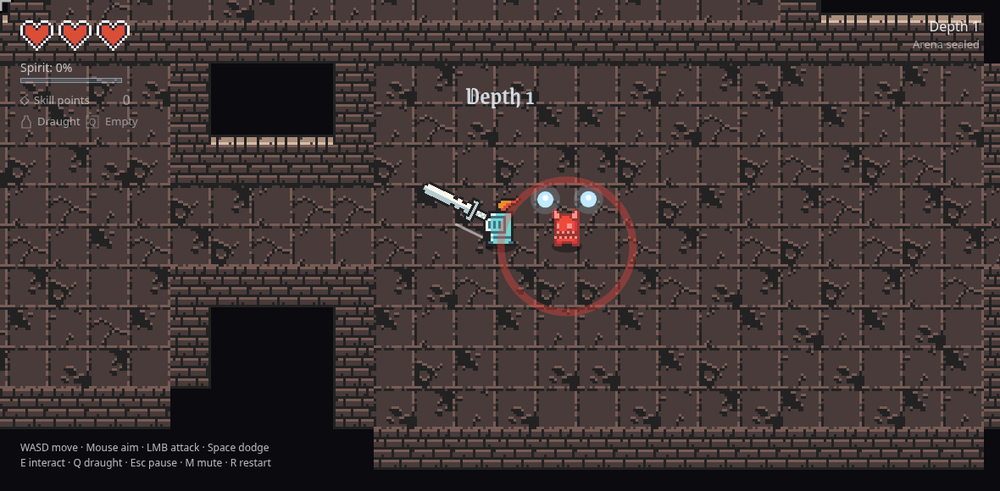

# skill issue dg

[](https://github.com/Wesley-Nunes/skill-issue-dg/actions/workflows/vitest_tests.yaml)
[](https://github.com/Wesley-Nunes/skill-issue-dg/actions/workflows/cypress_tests.yaml)

**▶ Play in your browser: [skill-issue-dg.vercel.app](https://skill-issue-dg.vercel.app)**

A dark-fantasy action roguelike vertical slice.  
Descend through a seeded dungeon branch, break a mob's spirit fragments without taking a hit, put it to
rest, and summon the **Floor Warden**. Defeat it to open the stairs and go deeper.  
Death is the only end.



## Table of Content

- [Motivation](#motivation)
- [Design & Architecture](#design-and-architecture)
- [Tech Stack](#tech-stack)
- [How to Run](#how-to-run)
- [License](#license)
- [Author](#author)

## <a name="motivation">Motivation</a>

I decided to develop this game because I want to test my skills in agentic development.  
I used _only_ the free tier of OpenCode with DeepSeek V4.1 Flash Free. It took around seven days to achieve the **fully playable** MVP - `version 0.9.0`.

### AI agent

> Session: "AI agent" was written by the AI agent.

#### Role and contribution

**skill issue dg** was built by a human operator working with an AI coding agent
in a small, explicitly defined team structure. The operator owned product intent
and every acceptance decision. The AI agent owned planning, documentation,
design, implementation, testing, and release bookkeeping — and recorded all of
it in the repository.

The shipped game contains no AI. No model, API, or adaptive behavior runs at
runtime; enemy "AI" is ordinary deterministic game logic. AI was a development
tool, not a feature.

#### What the agent was responsible for

| Role             | Responsibility                                                                                                              |
| ---------------- | --------------------------------------------------------------------------------------------------------------------------- |
| Orchestrator     | Owned the version plan, branch and PR lifecycle, integration, code review, and final acceptance; kept `STATE.md` truthful.  |
| Docs agent       | Ran product discovery with the operator and wrote the MVP contract, product overview, and per-version task handoffs.        |
| Design agent     | Turned approved tasks into concrete visual and interaction decisions (layout, HUD, feedback, accessibility).                |
| Programmer agent | Implemented the approved scope in TypeScript/Canvas, with unit and browser tests, and wrote an implementation decision log. |
| QA agent         | Independently verified behavior against the task and design contract, recorded evidence, and returned work when it failed.  |

Stages ran in a fixed order — **docs → design → programmer → QA** — each behind
an orchestrator gate. Product questions went to the operator one at a time;
implementation details were resolved by the agent under KISS, YAGNI, separation
of concerns, and pragmatism.

Concretely, that is roughly 7,300 lines of TypeScript plus 3,450 lines of unit
tests, 198 unit tests, 33 Cypress browser tests, zero runtime dependencies, a GitHub Actions
workflow, and a live Vercel build.

#### How the work is traceable

Every version left a consistent paper trail, so any decision can be checked
against the code:

```text
GOAL.md                                   MVP contract and success criteria
STATE.md                                  current version, phase, branch, blockers
docs/about-the-project.md                 product vision and game rules
docs/tasks/<version>/<task>-*.md          docs → design → programmer → QA handoffs
design/<version>/design-decisions.md      approved visual/interaction contract
programmer/<version>/CoT.md               implementation decision log
qa/<version>/<task>-report.md             verification evidence and verdict
```

Commits follow
`<type>(<scope>): <summary> [<version>/<task>/<agent>]`, so history shows which
role produced each change. Quality evidence is recorded rather than asserted:
QA reports cite commands, commit hashes, test counts, captures, and known
limitations.

#### Honest limits

- **The operator made the product calls.** Scope, feel, and acceptance were not
  delegated to the agent.
- **Automated tests prove rules and pixels, not fun.** No human playtest
  substitute was recorded for "feel" judgments.
- **The workflow is heavier than the game.** The process artifacts are a
  deliberate part of the portfolio value: they show how the work was planned,
  reviewed, and verified.

## <a name="design-and-architecture">Design & Architecture</a>

Game rules stay independent from rendering and input.  
Systems are pure where practical; the engine coordinates them and owns the mutable run state.

### Project structure

```text
src/
  game/
    data/       static data: config, floor generation, sprite file names
    systems/    deterministic rules: combat, enemy AI, bombs, collision
    engine/     orchestration and the run state machine
    types/      domain types shared across layers
  state/        runtime state factories
  ui/
    audio/      Web Audio manager and synthesized boss layers
    boot/       boot loading-screen progress and DOM controller
    input/      keyboard and pointer translation
    rendering/  canvas renderer and visual effects
    styles/     page styling
cypress/        end-to-end specs and shared commands
```

See [`docs/about-the-project.md`](docs/about-the-project.md) for the product
direction, [`GOAL.md`](GOAL.md) for the MVP contract, and
[`STATE.md`](STATE.md) for the current workflow state.

## <a name="tech-stack">Tech Stack</a>

| Area           | Technology                   |
| :------------- | :--------------------------- |
| **Frontend**   | TypeScript, Canvas 2D API    |
| **Testing**    | Cypress (E2E), Vitest (Unit) |
| **Build Tool** | Vite                         |
| **Deployment** | Vercel                       |

## <a name="how-to-run">How to Run & Requirements</a>

### Requirements

- A desktop browser with a keyboard and mouse (Chrome or Edge recommended).
- [Node.js](https://nodejs.org/) 22 or newer and npm, for development only.
- No install or account. Progress is held in memory, so closing the tab ends
  the run.

### Run locally

```bash
npm install
npm run dev
```

> Open the URL printed by Vite `http://localhost:5173`.

### Production Build

```bash
npm run build
npm run preview
```

> Open the URL printed by Vite `http://localhost:4173`.

### Preview

Play **[Skill Issue DG](https://skill-issue-dg.vercel.app)** 🎮 (v0.9.0)

### Controls

| Input                     | Action                                       |
| ------------------------- | -------------------------------------------- |
| `WASD`                    | Move                                         |
| Mouse                     | Aim                                          |
| Left mouse button         | Light attack (one committed swing per press) |
| `Space`                   | Dodge (brief invulnerability)                |
| `E`                       | Interact: browse the shop, summon the Warden |
| `Q`                       | Use the carried healing draught              |
| `W` / `S` or `↑` / `↓`    | Move the shop selection                      |
| `Enter`                   | Confirm a shop purchase                      |
| `Enter` / `Space` / click | Start from the title screen                  |
| `Esc`                     | Pause / resume; close the shop               |
| `M`                       | Mute / unmute                                |
| `R`                       | Restart after death                          |

#### Gameplay loop

**0.9.0 version**:

1. A floor is a seeded six-room branch: start, first mob, a junction, a shop
   dead end and second mob on the left, and a third mob plus the gated Warden
   arena on the right. Room sizes and decoration vary by seed; the layout does
   not.
2. Each mob carries spirit fragments. Break every fragment with a light
   attack without taking damage, then land the killing blow to put the mob to
   rest. A conventional kill returns the mob.
3. Resting a mob earns 1 skill point. Resting all three fills the spirit meter
   and opens the arena gate. Summoning is a deliberate act: press `E` at the
   altar inside the arena.
4. The shop is a safe room off the junction. Its protection applies between
   encounters only: while a living enemy hunts you, the threshold turns ember
   and refuses entry, and the shop cannot be opened. Leaving the safe room is
   always allowed. Browse with `E` to buy a healing draught for 1 point (one
   slot, heals 2 HP, use with `Q`) or Vigor for 3 points (+1 maximum and
   current HP, once per run). The shop closes permanently for the floor when
   the Warden is summoned.
5. Inside the open arena, press `E` at the altar to summon the Floor Warden.
   It chases, swipes at close range, and throws fused bombs at range. Defeating
   it awards 3 skill points and opens the stairs.
6. Descending generates a new floor, restores 2 HP, and resets spirit, gate,
   boss, and shop state. Skill points, a carried draught, Vigor, and the raised
   maximum HP persist for the run and reset on death.

## <a name="license">License</a>

This project is licensed under the MIT License.

## <a name="author">Author</a>

Developed by **Wesley Nunes**

- [GitHub](https://github.com/Wesley-Nunes/)
- [LinkedIn](https://www.linkedin.com/in/dev-wesley-nunes)
